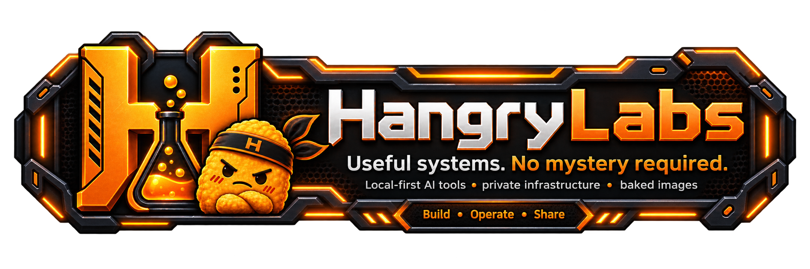

<p align="center">
  
</p>

<p align="center">
  <a href="README.md">English</a> ·
  <a href="README.nb.md">Norsk bokmål</a> ·
  <a href="README.pl.md">Polski</a> ·
  <a href="README.ja.md">日本語</a> ·
  <strong>简体中文</strong> ·
  <a href="README.es.md">Español</a>
</p>

# 🧪 Hangry Labs

**本地优先的 AI 和开源软件，封装后即可在你掌控的硬件上运行。为了人类，也为了鸡块的力量。**

Hangry Labs 构建实用且可自行托管的 AI 系统、自动化工具、仪表盘、标准规范和创作工具。我们封装困难部分，提供实用界面，并如实说明现实中的取舍，让强大的软件更容易运行、理解、连接和保存。

访问 [Hangry Labs 软件目录](https://hangrylabs.app/zh/software)，查看产品指南、真实示例和安装帮助。

因为有时你只是想让它正常工作。  
而不是召唤十二个依赖恶魔，再把整个周末献祭给 Python 环境。

---

## ⚡ 选择工具，立即运行

[软件目录](https://hangrylabs.app/zh/software)展示已完成新版 Hangry Labs 界面和封装更新的应用。你可以在下载任何内容之前比较这些应用，并试听真实的语音示例。

对于基于 Docker 的语音工具，每份安装指南都会询问六个简短问题，内容包括操作系统、硬件、下载大小、发布通道、镜像仓库和网络访问范围。随后，它会生成一条准确的命令，并用清楚的语言解释每个步骤。你的答案只保留在浏览器中，不会提交到服务器。

选择一个项目，打开 **安装帮助**，把生成命令这条支线任务交给安装向导。

---

## 🌍 Hangry Labs 为何存在

现代 AI 工具功能强大，但许多工具依赖托管服务、隐藏的基础设施、随时可能失效的模型链接、复杂的配置仪式或外部账户。

Hangry Labs 选择一种更独立的方式：

- 在本地或你掌控的基础设施上运行工具
- 让提示词、声音、转录、文档和图像保持私密
- 提供清楚的 Docker 命令和合理的默认设置
- 在可行时包含模型和依赖项
- 为用户提供浏览器界面，为应用提供有文档的 API
- 如实发布硬件指南、测量结果和限制
- 保留上游项目的署名、许可证和链接

理想的首次体验应该像这样：

```text
docker run ...
```

然后它就能运行。

也许并非每次都完美。我们仍在扑灭依赖项引发的火灾。但这就是我们的方向。

---

## 🧰 应用

最初的本地语音工具已经发展成更广泛的 AI、运维和创作软件集合。

| 项目 | 领域 | 提供的功能 |
|---|---|---|
| [**KokoroTTS**](https://github.com/hangry-labs/kokoroTTS) | 快速本地语音 | 11 种语言的 173 个声音、五个可独立管理的模型包、流式生成、SSML 对话、原生与 OpenAI 兼容 API，以及可选的 MCP 工具。 |
| [**MeloTTS**](https://github.com/hangry-labs/MeloTTS) | 多语言语音 | 六种语言的八个模型、浏览器模型管理、六种输出格式、逐句 MP3 和 PCM 流，以及原生与 OpenAI 兼容 API。 |
| [**OmniVoiceTTS**](https://github.com/hangry-labs/OmniVoiceTTS) | 语音实验室 | 支持 600 多种语言，具备声音设计、麦克风与参考音频克隆、可复用配置、SSML-H 对话、流式生成和 OpenAI 兼容 API。 |
| [**VoxCPMTTS**](https://github.com/hangry-labs/VoxCPMTTS) | 创意语音 | 由 Nano-vLLM 驱动的 30 种语言生成、自然语言声音设计、参考音频与转录引导克隆、可复用配置、渐进式流和 HTTP API。 |
| [**Qwen3-ASR-STT**](https://github.com/hangry-labs/Qwen3-ASR-STT) | 语音转文字 | 本地 30 种语言转录、实时麦克风会话、时间戳与字幕、OpenAI 兼容客户端，以及可选的文件和 URL MCP 转录。 |
| [**llama.nodrama**](https://github.com/hangry-labs/llama.nodrama) | LLM 运维 | 用于查看 llama.cpp 槽位、队列、吞吐量、KV 缓存行为、请求时间线，以及本地 LLM 端点背后运维细节的轻量仪表盘。 |
| [**see-through**](https://github.com/hangry-labs/see-through) | 创作工具 | 私密的本地动漫角色图层分解，支持分层 PSD 导出、交互式深度预览、手动排序、选择性重新生成和源图细节恢复。 |

不同的引擎和工具各有所长。我们按照它们真正擅长的任务进行封装，而不是假装一个模型能够解决所有问题。

不同的灾难，需要不同的鸡块。

### 标准与基础组件

| 项目 | 角色 | 当前重点 |
|---|---|---|
| [**Faster Qwen3-TTS**](https://github.com/hangry-labs/faster-qwen3-tts-studio) | 高性能运行时 | 支持流式与非流式的实时 Qwen3-TTS 推理，包含 CUDA Graph 加速、OpenAI 兼容服务器，以及面向 CUDA 和 Apple Silicon 的实验性 GGML 后端。 |
| [**SSML-H 规范**](https://github.com/hangry-labs/ssml-h-spec) | 语音标记 | Hangry Labs 为 W3C SSML 1.1 创建的独立扩展配置文件的规范来源，包含动态声音声明和逐轮指令。 |
| [**SSML-H Tools**](https://github.com/hangry-labs/ssml-h-tools) | 参考库 | 与引擎无关的 Python 解析器、验证器和构建器，可将 SSML 和 SSML-H 编译为不可变的合成计划。 |

---

## 🛠️ 我们如何构建

### 本地优先，默认私密

你的数据应该留在身边。Hangry Labs 项目力求在你的机器或服务器上运行，而不把敏感输入发送到别人的云端。

### 在可行时完整封装

完整 Docker 镜像可以包含模型资源、运行时依赖项和应用本身。当完整封装并不实际时，项目可以提供较小的镜像，并配合稳定的持久化数据卷使用。

目标是可靠性，而不是赢得最小镜像比赛。一个明年仍能运行的较大镜像，通常比一个会因软件包变化或模型链接失效而损坏的小镜像更有用。

### 开放接口

用户应该拥有清晰的浏览器界面。应用和自动化流程应该拥有文档完善的 HTTP API、实用的状态端点和可预测的行为。

在适合使用 OpenAI 兼容 API 的地方，我们将其作为实用的兼容基线，同时保留有价值的产品专用功能。

### 如实说明限制

速度快的模型可能能力范围更窄。强大的模型可能需要更多内存和耐心。基准测试应该说明使用的硬件和设置，兼容性指南也应该清楚说明实际测量了什么。

没有魔法烟雾，只有略带戏剧性的工程现实。

### 尊重上游工作

许多 Hangry Labs 项目建立在优秀的开源研究和软件之上。我们保留清晰可见的上游署名和许可证，说明哪些部分来自上游，并记录 Hangry Labs 在封装、界面、部署和验证方面增加了什么。

---

## 🚀 长期方向

Hangry Labs 仍是一间探索实用支线任务的实验室。更广泛的方向包括以下本地优先工具：

- AI 伙伴与语音界面
- 记忆与知识系统
- 自托管仪表盘
- 私密自动化
- 创作工具
- 游戏与直播实用程序
- 模型服务与可观测性
- 语音标记与互操作性
- 快速、可复现的 AI 推理

我们的目标是一组人们能够运行、理解、修改、连接和保存的工具。

并非所有东西都需要成为云订阅。有些东西应该真正属于使用它们的人。

---

## 🧃 为了人类与鸡块的力量

我们为希望自己运行软件的人而构建。

为了动手构建的人。<br>
为了创作者。<br>
为了隐私。<br>
为了奇怪的实验。<br>
为了那些最终变成大型项目的小修复。<br>
为了人类。

当然，也为了鸡块的力量。

请查看下方置顶的仓库，了解目前最受关注的项目。
